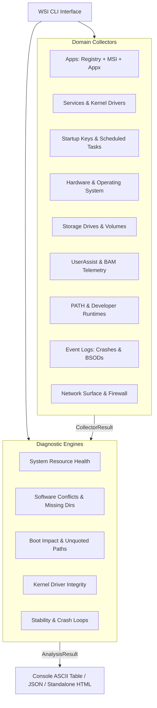

<div align="center">

# 🔍 Windows System Intelligence (WSI)

### *High-Performance, Zero-Modification System Inventory & Diagnostic Engine for Windows*

[](https://github.com)
[](https://github.com)
[](https://github.com)
[](LICENSE)
[](SECURITY.md)

<p align="center">
  <b>WSI</b> is an open-source diagnostic and forensics inventory toolkit engineered for system administrators, security auditors, and developers. It audits host health, software conflicts, boot latency, kernel drivers, listening ports, and event log telemetry in under <b>15 seconds</b> with <b>zero modifications to the host operating system</b>.
</p>

[Features](#-key-features) • [Safety Invariants](#-strict-read-only-safety-invariant) • [Quick Start](#-quick-start) • [Architecture](#-architecture) • [CLI Reference](#-cli-usage) • [Contributing](#-contributing)

</div>

---

## 🛡️ Strict Read-Only Safety Invariant

WSI is designed specifically to run safely on production systems, developer workstations, and forensic analysis targets:

- **100% Non-Destructive**: Zero writes to the Windows Registry, filesystem, or service configuration.
- **Enforced Read-Only Registry**: Every key is accessed via `winreg.KEY_READ` with explicit 64-bit and 32-bit (`KEY_WOW64_64KEY`) enumeration.
- **No Elevated Dependency**: Runs out-of-the-box in unprivileged user sessions. Artifacts requiring admin access (e.g. raw Prefetch dir) are handled gracefully without terminating execution.
- **Disabled Repair Architecture**: All repair/mutation hooks are strictly disabled by design.
- **Safe CI/CD & Testing**: 100% of test suites execute against synthetic mock fixtures.

---

## ✨ Key Features

### 📡 Read-Only Inventory Engines
| Domain | Collector Key | Data Harvested |
|---|---|---|
| **Applications** | `installed_apps` | Registry (HKLM/HKCU 32/64-bit), MSI Installer database, and MSIX/Appx modern packages. |
| **Services & Drivers** | `services` | All Windows services and active kernel/system drivers with startup modes, PID, and run-as accounts. |
| **Startup Programs** | `startup` | Run/RunOnce registry entries, user/machine startup folders, and active scheduled tasks. |
| **System & Hardware** | `system_info` | OS build numbers, CPU architecture, memory capacity, BIOS version, motherboard, and NIC configs. |
| **Storage & Volumes** | `storage` | Logical volumes, file system health, free vs used ratios, and physical drive models. |
| **Execution History** | `execution_history` | Forensic execution traces from UserAssist (ROT-13 decoded) and Background Activity Moderator (BAM/DAM). |
| **Environment & PATH** | `environment` | Complete environment variables, PATH dead-link & duplicate directory analysis, and dev runtime probing. |
| **Critical Event Logs** | `event_logs` | BSOD BugChecks (`1001`), unexpected shutdowns (`6008`), disk I/O warnings, and app crash loops (`1000`/`1002`). |
| **Network Surface** | `network_surface` | Windows Firewall profile states, active listening TCP ports, owning PIDs, and SMB network shares. |

### 🧠 Analytical Diagnostic Engines
- **Health Analyzer (`health`)**: Real-time disk capacity exhaustion alerts (<10% or <15 GB), stopped automatic system services, and missing directories referenced on `PATH`.
- **Software Conflict Analyzer (`software`)**: Detects multi-version duplicates and broken registry entries pointing to uninstalled directories.
- **Startup & Boot Impact Analyzer (`startup_impact`)**: Flags high boot footprint (>30 items), unquoted binary paths containing spaces, and duplicate startup targets.
- **Driver & Kernel Security Analyzer (`driver_security`)**: Audits running kernel drivers executing outside standard system directories (`System32\drivers`).
- **Event Health Analyzer (`event_health`)**: Detects recurring application crash loops, storage controller alerts, and unstable power-off patterns.

---

## 🚀 Quick Start

### 1. Clone & Set Up (Standard Library First)

WSI requires **Python 3.10+** on Windows. The core engine uses **only standard library modules** with zero external dependencies required for execution:

```powershell
# Clone the repository
git clone https://github.com/<your-username>/windows-system-intelligence.git
cd windows-system-intelligence

# Create and activate an isolated virtual environment
py -3 -m venv .venv
.venv\Scripts\Activate.ps1
```

### 2. Generate an Interactive Offline HTML Dashboard

Run the full diagnostic suite and compile a standalone, interactive dashboard in one command:

```powershell
python -m wsi.cli diagnose --html wsi_dashboard.html
```

Open `wsi_dashboard.html` in any browser:
- **Instant Client-Side Filtering**: Search across hundreds of installed applications, services, and ports in milliseconds.
- **Color-Coded Diagnostic Findings**: Critical, warning, and informational findings with remediation advice.
- **Completely Self-Contained**: 0 external CDN links or remote font calls—functions 100% offline.

---

## 💻 CLI Usage

```powershell
# Display all available collectors and analyzers
python -m wsi.cli list

# Run full diagnostics in console view
python -m wsi.cli diagnose

# Run full diagnostics and export machine-readable JSON
python -m wsi.cli diagnose --json -o audit.json

# Query an individual domain
python -m wsi.cli inventory -c storage
python -m wsi.cli inventory -c environment
python -m wsi.cli inventory -c network_surface
python -m wsi.cli inventory -c event_logs
```

---

## 🏗️ Architecture



---

## 🧪 Testing

The test suite validates data structures, edge-case parsing, and analytical logic exclusively with synthetic mock fixtures:

```powershell
python -m unittest discover -s tests -v
```

```text
Ran 22 tests in 0.002s
OK
```

---

## 🤝 Contributing

We welcome community contributions! Please read our [Contributing Guidelines](CONTRIBUTING.md) and [Code of Conduct](CODE_OF_CONDUCT.md).

All contributions must strictly uphold the [Read-Only Safety Policy](SECURITY.md).

---

## 📄 License

This project is licensed under the [MIT License](LICENSE).
